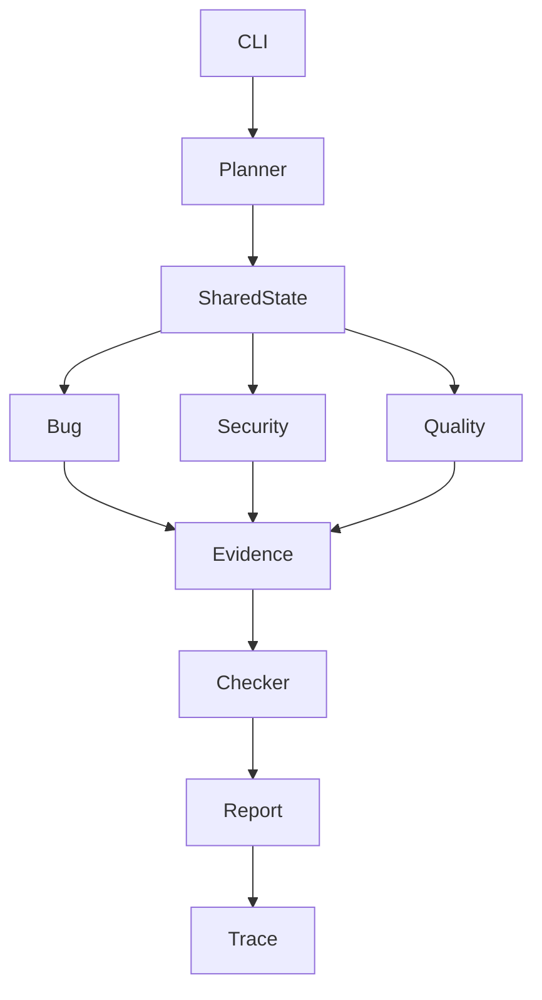

# Agentic Code Review Harness — A Reliable Multi-Agent Engineering Team

An independent internship-evaluation implementation. This is not an official ByteVox or Aurigen Labs project.

## Overview

A CLI tool accepts a natural-language review task and a local Python project. A planner prepares a structured plan; bug, security, and quality specialists run concurrently; deterministic source evidence checks and a checker filter candidates; JSON/Markdown reports and a JSONL trace are saved locally.

Mock mode is deterministic simulation only. It validates orchestration mechanics and is not evidence of LLM review quality. Live mode uses the official OpenAI SDK and requires explicit paid-call approval.

## Architecture



## Agents and tools

- **Planner:** structured task plan; no source-reading or shell access.
- **Bug detector:** reads approved source files and line ranges.
- **Security reviewer:** reads source and searches text.
- **Code quality reviewer:** reads source and safe project metadata.
- **Checker:** deterministic evidence validation plus model decision; no unrestricted project access.
- **Single-agent benchmark:** intended consolidated reviewer comparison; see limitations below.

Tool registry permissions are centralized. Paths are resolved under the approved root; traversal, outside-root symlinks, credential files, unsupported extensions, oversized files and common generated directories are excluded. Tools are read-only. Repository text is explicitly marked untrusted in prompts. Prompt-injection tests show only specific tested behavior, not a guarantee against all attacks.

## Installation

Python 3.11+ recommended.

```bash
python -m venv .venv
source .venv/bin/activate
python -m pip install -r requirements.txt
export PYTHONPATH=src
```

Copy `.env.example` to `.env` and set environment variables manually if using live mode. The CLI does not automatically load `.env`; export variables in your shell or use your preferred environment loader. Never commit secrets.

## Run

```bash
PYTHONPATH=src python -m agent_harness run --task "Review this project for bugs and security risks" --path samples/task_1 --mode mock
PYTHONPATH=src python -m agent_harness run --task "Review this project for bugs and security risks" --path samples/task_1 --mode live --approve-paid-calls
PYTHONPATH=src python -m agent_harness benchmark --mode mock
PYTHONPATH=src python -m agent_harness replay --trace runs/RUN_ID/trace.jsonl
```

Live mode requires `OPENAI_API_KEY`; `OPENAI_MODEL` selects the model and `OPENAI_BASE_URL` is optional. Pricing variables are optional. Cost is unavailable when reliable price inputs and token accounting are unavailable. Never assume a missing cost is zero. Remote calls may incur charges once explicitly approved.

## Resource limits and failure handling

Default `RunLimits` bounds wall-clock duration, interactions, model calls, token estimates, per-agent time/steps, retries and checker correction rounds. Shared budget reservations are guarded by an async lock. Transient provider errors are retried with exponential backoff in live mode. Specialist errors are captured while other specialist results are retained. Checker failures never mark candidates as verified.

## Reports and traces

Each run creates `runs/<run-id>/trace.jsonl`, a JSON report, and a Markdown report. Traces are local and may contain source snippets or task text; treat them as sensitive. API keys and likely secret patterns are redacted. Replay only reads the trace and never invokes a model.

## Tests

```bash
PYTHONPATH=src pytest -q
```

## Benchmark methodology and scorecard

Three synthetic tasks are provided with separate ground truth. `benchmarks/scorecard_template.csv` provides a manual assessment rubric: correctness, evidence, coverage, and actionability each score 0–2. Unsupported findings reduce correctness and coverage; missed known issues reduce coverage; evidence that fails source matching receives no evidence credit. Keyword matching alone is not semantic validation.

**Benchmark quality scores are pending human/semantic assessment.** Mock results test only the mechanics. The current benchmark runner captures timing and report counts but its single-agent workflow is not yet a genuinely distinct baseline; do not use it to claim multi-agent superiority. Run a live, budget-matched baseline before drawing quality or cost conclusions.

## Limitations / cut scope

- The initial version focuses on a CLI and read-only review.
- Tool schemas are validated by Python argument checks rather than a complete provider-native tool-calling loop.
- Checker correction rounds are represented in configuration but automated specialist revision routing is not yet implemented.
- Token budgets use conservative character-based estimates; provider usage reconciliation and hard cost-ceiling enforcement are incomplete.
- Per-agent deadline/interaction enforcement is not fully independent; overall wall-clock timeout is enforced.
- The current benchmark's single-agent baseline is a placeholder and must be implemented before comparative claims.
- Actual time spent and a genuine AI-generated mistake are not asserted here because they were not independently measured in this environment.

## Engineering trade-offs

The code favors readable Python, explicit models, and a small dependency surface over an agent framework. Evidence matching proves that a quoted snippet exists at a location; it does not prove the interpretation is correct. Mock mode intentionally returns no specialist findings unless a test fixture supplies them, avoiding fabricated findings.

## Demo

See `DEMO_SCRIPT.md` for a reproducible walkthrough. Use mock mode to demonstrate orchestration and use live mode only with explicit cost approval.
