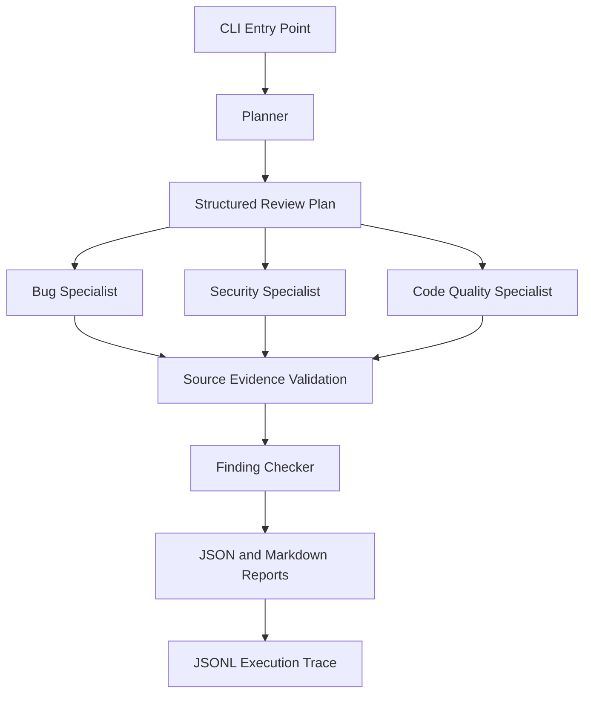

# Agentic Code Review Harness

A Python-based multi-agent code review system that investigates potential bugs, security vulnerabilities, reliability problems, and code-quality issues. It validates findings against source evidence and produces structured review reports.

**Repository:** [agentic-code-review-harness](https://github.com/Kiran111L/agentic-code-review-harness)

> This is an independent internship-evaluation implementation, not an official ByteVox or Aurigen Labs project.

## Overview

The harness accepts a natural-language review task and a local Python repository. A planner prepares the review plan, specialist agents examine the code, source-evidence validation checks candidate findings, and a checker evaluates them before reports are generated.

### Architecture



## Key Features

- Multi-agent review orchestration for bug, security, and code-quality analysis.
- Structured findings with categories, severity, source locations, evidence, explanations, and suggested fixes.
- Source-evidence validation to reject findings that do not meet the configured requirements.
- JSON and Markdown report generation.
- JSONL execution traces for inspecting workflow activity.
- Benchmark runner for comparing configured review workflows.
- Mock mode for deterministic workflow and testing checks.
- Optional live model integration, subject to configuration and explicit cost approval.

## Technology Stack

- Python
- Async agent orchestration
- Pydantic-based structured data validation
- OpenAI SDK for live model integration
- Ollama integration where supported by the project configuration
- Pytest for automated testing
- JSON, Markdown, and JSONL for reports and traces

## Setup

Python 3.11 or later is recommended.

```bash
git clone https://github.com/Kiran111L/agentic-code-review-harness.git
cd agentic-code-review-harness

python3 -m venv .venv
source .venv/bin/activate

pip install -r requirements.txt
```

If your environment requires it, expose the source directory:

```bash
export PYTHONPATH=src
```

## Usage

See the available commands and options:

```bash
python -m agent_harness --help
```

Run the deterministic mock workflow against a sample:

```bash
python -m agent_harness run \
  --task "Review this project for bugs and security risks" \
  --path samples/task_1 \
  --mode mock
```

Run the mock benchmark:

```bash
python -m agent_harness benchmark --mode mock
```

Replay a saved execution trace:

```bash
python -m agent_harness replay --trace runs/RUN_ID/trace.jsonl
```

Replace `RUN_ID` with an actual run identifier from your local `runs/` directory.

### Live model mode

Live mode depends on the providers and configuration supported by your installation. Configure the required credentials and model settings before using it. Where the CLI requires paid-call approval, pass the appropriate explicit approval flag.

**Important:** Live model calls may incur charges. Check your provider's pricing and the CLI options before running them.

## Testing

Run the automated test suite:

```bash
pytest -q
```

The current development test suite has passed all 25 tests.

## Benchmark Interpretation

Mock benchmark results measure workflow mechanics, not the quality of a language model's code review.

Benchmark scores should be interpreted in the context of the implemented matching and validation rules. They are not independent proof that every detected issue is correct or that every real vulnerability will be found. Model quality should be evaluated separately using representative examples and manual or semantic review.

## Limitations

- Model-generated findings may be incomplete or incorrect.
- Evidence and schema checks reduce unsupported findings but do not guarantee correctness.
- Benchmark matching is an approximation and may not fully capture semantic equivalence.
- Live model quality depends on the selected model, prompt, and provider configuration.
- Results should be reviewed by a developer before acting on suggested fixes.

## Project Goal

Demonstrate practical engineering concepts for building and evaluating an agentic code-review workflow, including specialist roles, evidence validation, structured reporting, traceability, and benchmark testing.


## Benchmark Results

The harness was evaluated on three synthetic code-review tasks covering an empty-list edge case, unsafe use of `eval()`, and file-handle reliability.

| Metric | Multi-agent | Single-agent baseline |
|---|---:|---:|
| Tasks completed | 3/3 | 3/3 |
| Mock-mode precision | 1.00 | 1.00 |
| Mock-mode recall | 1.00 | 1.00 |
| Mock-mode F1 | 1.00 | 1.00 |
| Total measured runtime | 0.008 s | 0.003 s |
| Estimated input tokens | 582 | 54 |

**Interpretation:** These results validate the mock workflow and scoring mechanics only. They do not demonstrate that multi-agent AI produces better reviews. The mock multi-agent workflow took longer and used more estimated input tokens. A meaningful quality comparison requires equivalent live-model runs and a more robust semantic evaluation.

Token counts are estimates; measured runtime is specific to this local mock execution. Cost was not reported.
